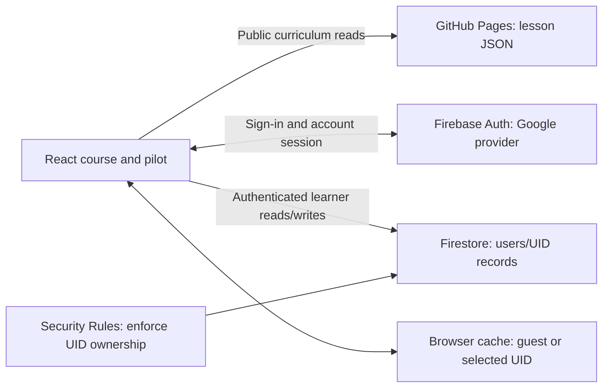

# Personal account persistence MVP investigation

Date: November 4, 2026. Status: research/proposal only. No application code, dependencies, Firebase projects, live settings, or Git history changed. This is the consolidated result of three native subagents covering product/journey, architecture/data, and providers/owner setup, independently synthesized by the main thread. It describes proposed work; no implementation or cloud provisioning has been performed.

## Provider selection update

Decision resolved: the owner selected Firebase. Owner-only Google Authentication and Firestore continuity have since been implemented and released. The investigation below remains historical proposal evidence; current behavior and acceptance are recorded in [the execution record](personal-cloud/EXECUTION.md) and web/README.md. See [the provider comparison](personal-cloud/provider-comparison.md) for the original tradeoffs.

## Confirmed MVP constraints — owner decision

The owner clarified that the only anticipated MVP user is the owner. This decision supersedes the broader public multi-user launch recommendations below. The account/data model can retain straightforward UID ownership so later expansion is possible; general-user onboarding, subscriptions and administrative features are not MVP work.

- **Free tier only:** Firebase Spark; no payment method, Cloud Billing linkage, Blaze upgrade, free-trial billing linkage, paid resource, subscription integration or automatic upgrade. Provider setup must use an unbilled project. If a required feature cannot work within this boundary, omit/defer it rather than enable billing.
- **Existing domain:** retain `codesagar.github.io/cissp-buddy/`; no custom domain, DNS purchase or domain-migration task for this MVP. Provider configuration still needs to authorize the existing hostname; this does not require buying a domain.
- **Serverless, managed services only:** retain React/TypeScript/Vite and GitHub Pages; the browser talks directly to Firebase Auth and Firestore under tested Security Rules. No custom backend/API, server functions, containers, D1 or paid automation is needed.
- **Personal account first:** Google sign-in for the owner, with owner-only cloud-record access enforced in rules (approved Firebase UID, not merely a hidden UI). Keep the normal per-UID structure; do not add a registration funnel, roles, tenant management or an admin console. Other-UID denial still needs emulator tests. Existing public static website/source visibility is unchanged by this cloud-data restriction.
- **Essential continuity only:** saved position, answers/snapshots/flags, notes, lab inputs, preferences, review and pilot resume, local recovery and explicit backup/migration. Insights remain grounded in existing evidence. No adaptive engine, new state framework, custom queue or conflict-resolution system.
- **Minimal setup:** one unbilled personal-MVP Firebase project plus local demo emulators. Separate hosted development/production projects and public-launch branding/support workflows are deferred until broader release warrants them.
- **Quota handling:** quota/service errors must show unsynced state and preserve recoverable local work; never silently upgrade. Spark requires no payment information, while linking a billing account upgrades the project to Blaze. [Firebase plan behavior](https://firebase.google.com/docs/projects/billing/firebase-pricing-plans).

Your immediate intervention is limited to choosing/authorizing the owning Google/Firebase account, normal login/MFA/consent, approving the Firestore location and minimal Google provider identity, and completing your real sign-in test so its UID can be authorized. SDK/configuration/rules/emulator work is agent-owned. No billing setup or DNS task is required.

## Recommendation and boundaries

Keep React/TypeScript/Vite, GitHub Pages, hash navigation, and release-pinned public curriculum JSON. Add Firebase Authentication (owner Google sign-in) and Cloud Firestore on Spark for private owner records, without linking billing. Retain guest study and export/import. This is a proposed next release, not a claim that the shipped single-learner application already has accounts.

The current browser store already survives ordinary reloads/reboots. Account-owned cloud data adds restoration after local storage loss, a different browser/device, and return sign-in. Auth persistence, cloud data, and offline caching are different mechanisms. Firebase local Auth persistence survives browser closure until sign-out, whereas session persistence ends with the session; sessions are origin-scoped. Set the choice explicitly and await Auth initialization before reading a UID. [Auth persistence](https://firebase.google.com/docs/auth/web/auth-state-persistence), [Auth observer initialization](https://firebase.google.com/docs/auth/web/manage-users).

Firebase is the best fit here as an engineering judgment: the existing JSON-shaped state and pure reducers can remain, while the SDK supplies account identity and database access directly from the static browser application. Supabase is credible if SQL ownership/querying becomes a priority: its Auth plus Postgres RLS can protect browser access. It would require a different persistence adapter and SQL/RLS migrations, with a separately designed offline policy; no first-party equivalent to the proposed Firestore cache behavior was established in this investigation. Never place Supabase administrative/secret keys in browser code. [Supabase RLS](https://supabase.com/docs/guides/database/postgres/row-level-security).

No custom grading server, new state framework, adaptive engine, event log, conflict-resolution system, custom retry queue, or curriculum database is needed. Ordinary last-write-wins is accepted. Restrict that policy to mutable records, rather than replacing a whole account and losing unrelated answers from another device.



## Verified implementation seams

| Current seam | Actual behavior | Proposed change |
|---|---|---|
| `web/components/course-app.tsx:90` `useLearner` | Loads/validates one global `cissp-buddy:course:v1` record; freezes autosave on damaged data; listens for cross-tab storage events; saves the whole state | Move these effects into an ordinary account-aware persistence hook; keep course reducers/renderers intact |
| `web/lib/course/learner-state.ts` | Pure `recordCourseAnswer`, scheduler use, scoped evidence, prerequisites, validation and combined restore | Preserve these types/functions; add cloud DTO conversion separately; keep semantic IDs, original snapshots and flags |
| `web/components/study-app.tsx:137` Home state/effects | Independent global `cissp-buddy:v1`, active quiz, local save/restore and cross-tab sync | Apply the same account identity boundary to the pilot; replace direct global writes with the same account-scoped storage seam |
| `web/lib/study-state.ts:170–246` | Pilot records an answer then later changes that attempt's `explanationMs` in `advanceSession` | Keep answer/snapshot/assistance fields immutable; allow only timing completion to change on legacy attempts |
| `web/components/study-app.tsx:234` | Active elapsed/phase clocks update state every second | Do not attach whole-state cloud autosave to this effect; checkpoint timing at bounded intervals/actions and keep local ticks current |
| Both Backup components | Existing course, original pilot, and combined formats; validated explicit replacement; damaged raw export | Preserve formats; separate active-account restore from legacy guest keys and ensure replacement targets the displayed account |
| `web/src/main.tsx`, `web/src/pilot.tsx` | Separate static entry documents | Initialize the same Firebase project/account hook from both entries; main/pilot transitions retain sign-in identity |

Current course `CourseAttempt` snapshots are about 3 KB at the largest of the 303 existing checks (measured maximum 2,972 serialized bytes; up to four options). Storing an entire growing attempt array in one document is still the wrong boundary: Firestore's document ceiling is 1 MiB. Use one document per attempt, not an account blob. Cloud conversion must validate/encode document keys separately while preserving original IDs in records/backups, and reject cloud-unrepresentable imports before writing; never truncate saved evidence. [Firestore limits](https://firebase.google.com/docs/firestore/quotas).

## Product proposal: an account-owned learning journey

The minimum useful change is **identity + durable learning records + evidence-based next actions**. A database alone will not make Today useful or keep accounts isolated.

For this personal MVP, the learner in this example is the owner. Example: a guest answers a prediction incorrectly, inspects the repair, changes a lab input and writes a note. They sign in and explicitly copy that browser's work into an uninitialized account dataset. Once the app confirms the cloud save, closing/rebooting the browser does not erase that record. The same account on a second device restores the saved stage, note, answer history and due review. Another learner on the first device sees their own record. If “remember this personal device” was declined, signing in again is expected; the learning record still survives in the account.

| Priority | Feature | User-visible result |
|---|---|---|
| Personal MVP | Guest study plus owner sign-in | Existing local work can be explicitly saved to the owner account; no public registration funnel |
| Personal MVP | Visible active identity and safe sign-out | Owner records stay separate from guest data; other identities have no cloud-record access |
| Personal MVP | Resume the actual journey | Unit/case/stage, figure step/variant, draft selection, notes, lab inputs, preferences, review and pilot quiz restore |
| Personal MVP | Honest save status | Distinguish restoring, saved on this device, syncing, saved to account, and needs attention |
| Personal MVP | Safe existing-progress adoption | Preview counts/destination; explicitly adopt uninitialized target datasets; never silently merge populated histories |
| Personal MVP | Small strengths/review-needs panel | Reuse Today/Practice; show the latest named-check evidence, assistance, dates and denominators |
| Personal MVP | Account-aware export and recovery | Existing course/pilot/combined formats retained; imports cannot choose a different UID or overwrite another learner |
| Personal MVP | Pilot continuity | Same sign-in at `/pilot/`; unfinished quiz, timing and history retain their own existing model |
| Future public launch | Privacy/support and automated account lifecycle | For the personal MVP, retain export and owner-operated cleanup; no paid deletion function |
| Next | Richer domain summaries/history browsing | Add only after exact scopes, loading completeness and observed usage justify it |
| Deferred | Instructor/admin roles, leaderboards, adaptive scoring, social features, new curriculum | None is required for private multi-user learning continuity |

### What “strengths and weaknesses” should mean

Use the latest response to each named current check together with the existing review need/date. Preserve earlier attempts as history. An old correct answer does not cancel a later mistake. `currentCourseEvidence` currently counts *any historical* correct unassisted response; retain that historical meaning or add a separate latest-evidence selector, rather than relabelling the old count “current strength.”

Good copy: “Two of this unit's three checks have a correct unassisted latest response”; “Review this decision: your last response used a hint”; “No answer evidence yet”; “Explained, without a directly scoped check.” Separate repeated familiar questions from first-response evidence. No mastery threshold, readiness percentage, exam pass prediction or adaptive engine is proposed.

The main manifest currently exposes 270 unit checks. The 33 connection checks have distinct scope; their index lists linked units/relationships, not all check/concept mappings. Initially label unit evidence and connection evidence separately. Do not credit a correct cross-case response to every linked domain. If one unified 303-check summary is wanted, a small generated metadata addition must expose exact IDs/scopes without downloading question bodies. Current verified coverage is 448 directly assessed concepts out of 698 explained concepts, not assessment of every concept in each visited unit.

## Proposed records

All private reads/writes live under `users/{uid}`. The UID comes from Auth, never from a form or imported backup. Keep provider/email identity in Auth; duplicate only a small optional display name if the product needs one.

```text
users/{uid}/state/main
  schemaVersion, lastUnitId, preferences, updatedAt
users/{uid}/courseUnits/{unitOrConnectionId}
  existing UnitPosition + existing ReviewCard (if any), updatedAt
users/{uid}/courseAttempts/{existingAttemptId}
  existing CourseAttempt unchanged, receivedAt

users/{uid}/state/pilot
  version, visited, completed, active quiz, updatedAt
users/{uid}/pilotAttempts/{existingAttemptId}
  existing Attempt; only explanationMs is subsequently mutable
users/{uid}/pilotNotes/{existingNoteId}
  existing Note
users/{uid}/pilotReviews/{conceptId}
  existing ReviewCard
users/{uid}/pilotSessions/{existingSessionId}
  completedAt, count, elapsedMs
```

These are ordinary records representing existing features. Do not create a separate persisted “strengths” score as another truth source. Reconstruct existing `LearnerState` and `StudyState`, then derive strengths/gaps from actual scoped attempts and review state. A visit remains exposure; an assisted/uncertain answer and repeated familiar answer remain distinguishable; no direct check means unknown assessment evidence. Historical IDs not in the current release remain in history.

An answer save is one small Firestore batch: attempt + corresponding unit/check-reference/review state. Keep the locally generated attempt ID for retries/imports; do not mint a new ID on network retry. Cloud rules allow creating answer evidence and an identical retry of the same immutable payload, but reject changing selected answer, correctness, snapshot or assistance fields. Pilot timing is the explicit compatibility exception above. Mutable position/preferences/review data use ordinary last-write-wins at their document/field boundary; write only affected fields so a note edit does not needlessly replace review state. Concurrent edits to the same field can still overwrite each other, as accepted. Firestore batches are atomic and work with offline writes; transactions have different retry/offline behavior and are unnecessary for this answer path. [Atomic batches](https://firebase.google.com/docs/firestore/manage-data/transactions).

For v1, hydrate the complete validated own-account history in bounded query pages before showing complete totals or enabling account autosave. The current selectors require full attempt arrays, and saved drafts refer to attempts by ID; a partially fetched list cannot be silently presented as the whole history. Cache complete snapshots and measure cold-load reads/latency with larger fixtures. Do not invent a summary engine. Later paging of visible history needs explicit complete summaries or equally explicit partial/loading labels. Query only the selected UID's collections; Firestore rules are not a post-query filter. [Rules/query behavior](https://firebase.google.com/docs/firestore/security/rules-conditions).

Recommend including pilot continuity in the account release. If scope is cut to main-course sync first, the pilot must visibly say “saved on this device only”; “all progress synced” must not be shown. This is a product decision, not an accidental omission.

## Initialization, ownership and recovery

The small hook should expose explicit states such as `checking account`, `guest ready`, `loading account`, `ready`, and `sync needs attention`. Do not render empty account state and let the existing autosave overwrite a populated cloud profile while authentication/hydration is unfinished.

1. Initialize Firebase once, configure the selected device/cache policy, then observe Auth. Use an identity-generation token so reads, listeners, debounced saves and completions from UID A cannot update UID B after an account change.
2. Guest mode continues using the unchanged legacy keys. On initial sign-in, treat them as an unclaimed local profile; validate and offer “Copy this device's learning to this account.” Never silently attach all guest history to every account that signs in.
3. Load only the new UID's cache and cloud documents. Do not use A's last state as B's loading placeholder. A cloud permission/network/validation failure is not an empty account: preserve records and show retry/export. Only confirmed absence can create an empty cloud profile.
4. Before enabling editing/autosave, assemble and validate complete state, including draft→attempt references. If concurrent document delivery makes a candidate incomplete, retain the last valid state and retry/finish hydration; do not save an empty repair over it.
5. Locally update through existing reducers. Save only affected records. Debounce note/position changes; save answer/draft transitions promptly; checkpoint the pilot clock on pause/answer/phase change and a modest interval rather than every second. An unload handler is only best effort.
6. Label “saved on this device”, “syncing”, “saved to your account”, “offline changes pending” and “sync failed” truthfully. A locally emitted snapshot is not a server acknowledgement: Firestore exposes pending-write metadata. [Listener metadata](https://firebase.google.com/docs/firestore/query-data/listen).
7. On sign-out/switch, cancel old UI work and subscriptions first. If writes are pending, offer bounded choices: wait while online, export and stay, or explicitly sign out/discard the local unsynced copy. Do not silently claim unsynced data reached the cloud. Never retarget pending A writes to B's path.
8. Namespace account caches by Firebase project and UID. In shared-device mode, keep account learning data in memory rather than persisting an application localStorage cache; in trusted-device mode, a validated owner-scoped persistent cache may be used. Sign-out clears visible account state, resets timers/drafts, and prevents global guest-storage events from being interpreted as signed-in account data. Returning to guest mode uses the guest record, not a copy of the last signed-in account.

Recommend a bounded v1 import contract: adoption/import is supported during first-time initialization of each target dataset (main course and pilot separately), before that dataset has a ready learning profile, with absence confirmed by the server. A ready dataset with zero displayed answers is not automatically eligible. A learner with populated main-course records may still adopt a pilot-only backup if the pilot dataset is uninitialized; combined adoption requires both target datasets uninitialized. If guest and cloud are both populated, continue the existing account and offer a guest export; do not silently merge or destructively replace the cloud account. Existing guest/local validated replacement remains available. Imported backups never change UID. This deliberately narrower signed-in restore policy needs product acceptance; do not claim full populated-account replacement.

A large backup cannot be made atomic by looping write batches. For first-time dataset adoption, atomically claim an ordinary `users/{uid}/state/import-main` and/or `import-pilot` marker (`status: importing`, source digest, expected record counts) only while that dataset has no ready profile; normal learning writes require its initialized/ready state. Claim both markers together for a combined source, and reject a simultaneous claim with a different digest. Block editing/honest-complete summaries for the affected dataset during import, and import bounded batches using the existing stable record IDs. Keep the original validated source in a UID-bound local migration copy where storage permits, or require the same exported file again after reboot. An idempotent restart can replay the same source; a different digest cannot silently replace it. Other devices see “initial import incomplete” for the affected dataset, not a usable partial profile; an unrelated ready dataset remains available. After a complete cloud reread validates all expected records and original evidence, an atomic final batch marks initialization ready and installs final main/pilot metadata. Do not erase legacy keys or the source file before this acknowledgement. An interrupted or canceled import stays visibly non-ready until resume or explicit cleanup; cleanup must not report complete before all partial records are removed. These are bounded dataset-initialization status records, not a custom queue or event-sourcing system.

Defer destructive replacement of an already populated cloud account until a separately reviewed recoverable design exists. Removing old records and uploading replacements across many batches can expose partial or lost history; a pre-export and an error message alone do not make it atomic. If full signed-in replacement is a must-have now, budget a narrowly scoped staged-generation/active-pointer design explicitly rather than hiding it in the adapter. Ordinary last-write-wins for normal mutable records remains unchanged.

## Device and cache policy

Recommend memory caching and session-only sign-in for shared devices by default, with explicit “remember me on this personal device” opt-in. Trusted-device mode can use Firebase local Auth persistence plus the SDK's persistent local cache, so pending SDK writes survive restarts without building our own queue. Firestore web persistence is off by default, supports specific browsers, and its cache is not automatically cleared between sessions. Test unsupported storage and multi-tab behavior rather than promising it universally. [Firestore offline cache](https://firebase.google.com/docs/firestore/manage-data/enable-offline).

Persistent cache clearing drops pending writes as well as cached documents, needs the Firestore instance stopped, and is not secure forensic erasure. Account transitions must finish/export/discard pending work deliberately before clearing. Do not offer persistent private caches on a shared-device path. [Firestore cache-clear API](https://firebase.google.com/docs/reference/js/firestore#clearindexeddbpersistence).

The current `/cissp-buddy/` path is not a separate browser origin from sibling projects under `codesagar.github.io`. Namespace prefixes avoid accidental mixing, not hostile same-origin scripts reading browser storage. A dedicated hostname is a possible future isolation improvement, explicitly deferred for this owner-only MVP; no domain or DNS dependency is introduced now. [Same-origin boundary](https://developer.mozilla.org/en-US/docs/Web/Security/Defenses/Same-origin_policy).

Use Google popup sign-in for the initial Pages implementation. Do not silently fall back to a redirect flow: Firebase documents extra work where cross-origin helper storage is blocked, and Pages cannot provide an arbitrary reverse proxy. Mobile popup/cancel/block cases need actual-browser acceptance. [Redirect-flow constraints](https://firebase.google.com/docs/auth/web/redirect-best-practices).

## Actual enforcement boundary and deletion

Firestore rules must deny unauthenticated access, bind all private paths to `request.auth.uid`, validate allowed fields/types/bounds, and restrict immutable-answer updates. They must never allow listing every user's records or rely on a UI-hidden UID. Rules are the cross-user data boundary, while application validation provides recovery/UX checks. Firebase web configuration/API keys are public identifiers, not credentials; administrative credentials must never enter the Vite bundle, repository or Pages artifact. [Owner-based rules](https://firebase.google.com/docs/firestore/security/rules-conditions), [Firebase public configuration](https://firebase.google.com/docs/projects/api-keys).

Client-written learning evidence is not tamper-proof grading: an owner can manipulate their own browser. Without a trusted grading backend, do not promise certified scores, anti-cheat protection, or exam readiness. That backend is unnecessary for the proposed personal learning profile.

Account deletion needs a concrete process for both Auth and learner documents. Deleting a parent Firestore document does not delete its subcollections. For this one-owner MVP, use owner-operated cleanup with export first; automated self-service deletion and any trusted backend task are deferred. Do not claim that Firebase Auth deletion alone erases the learning record. Do not add an automatic cleanup extension or paid function without explicitly choosing and testing that scope. [Deletion semantics](https://firebase.google.com/docs/firestore/manage-data/delete-data).

## Provider and owner-intervention checklist

Recommendation: **Firebase Authentication + Google popup sign-in + Firestore Standard/native mode**, retaining GitHub Pages. Google OAuth is the identity provider configured through Firebase Auth; it is not a second application backend or a reason to add a Google API SDK. Use basic identity scopes only, not Gmail/Drive access. Firebase documents its provider setup and generated auth handler. [Google provider setup](https://firebase.google.com/docs/auth/web/google-signin).

| Dependency/decision | What you need to decide or do | What the agent can do | Blocks |
|---|---|---|---|
| Owning Google/Firebase account | Choose personal/organization ownership and authorize the project; complete normal login/MFA/consent yourself | Build against a demo emulator project now; configure authorized cloud resources after access | Live cloud integration, not initial development |
| Personal MVP environment | Approve one unbilled project name | Use local demo emulators and synthetic data; no second hosted project required now | Live integration only |
| Firestore location | Approve region/data-location preference before database creation | Create the chosen database, rules and actual query indexes | Live database; location cannot be changed in place |
| Sign-in methods and audience | Owner Google account only; guest/local mode retained | Configure Google sign-in and owner-UID rules; no public onboarding, roles or admin UI | Owner sign-in identifies the allowed UID |
| Google identity/provider setup | Supply minimal app/support identity and complete normal consent or any provider-required verification | Configure the provider for the existing hostname; defer general-public launch polish | Owner real-provider acceptance |
| Existing authorized hostname | No purchase or DNS work | Authorize `codesagar.github.io`; keep the generated Firebase auth helper hostname | Real sign-in only |
| Free-only constraint | No billing setup, card, Blaze or paid resources | Keep Spark unbilled, use modest reads/writes and handle quota failures; defer incompatible features | Non-negotiable MVP boundary |
| Private-device policy | Recommended: shared/session mode by default; explicit remember/trusted-device opt-in | Implement cache lifecycle, pending-write decisions and tests | UX/persistence contract |
| Personal data lifecycle | Owner export/manual cleanup is sufficient for MVP | Preserve backups and document cleanup; no funded automation or public support system | Broader self-service lifecycle deferred |
| Provider deployment access | Authenticate CLI or approve narrowly scoped IAM/OIDC access when needed; never paste private keys into chat or Vite | Deploy tested rules/indexes and wire CI with proper access | Production writes must remain disabled until rules are deployed |
| Owner account/device acceptance | Sign in normally on your chosen devices; complete provider consent | Test own-account continuity and emulator rejection of other UIDs; collect receipts | Personal MVP acceptance |

Firestore location and web-app setup are provider facts; the recommended choices are our proposal. [Locations](https://firebase.google.com/docs/firestore/locations), [web setup](https://firebase.google.com/docs/web/setup). Google's production guidance distinguishes basic identity scopes from branding/verification: do not assume either that sensitive Google API access is needed or that branding work is automatically waived. For this personal MVP use demo emulators plus one unbilled project; revisit separate hosted environments and public branding at general release, while respecting any provider requirement actually imposed. [Production readiness](https://developers.google.com/identity/protocols/oauth2/production-readiness/overview), [authentication policy/branding](https://developers.google.com/identity/verification/authentication-policy-compliance).

For real-provider development, add `localhost` explicitly in the development project if needed: projects created after April 28, 2025 no longer include it automatically. Keep emulator use and production allowlists separate. [Auth domain guidance](https://firebase.google.com/docs/auth/faq-and-troubleshooting).

For the current host, an authorized domain is a hostname, not `/cissp-buddy/`. Retain the project's generated `authDomain` such as `PROJECT.firebaseapp.com`; the handler is `https://PROJECT.firebaseapp.com/__/auth/handler`. GitHub Pages does not serve that helper. A dedicated custom hostname improves browser-origin isolation but does not, by itself, solve redirect-helper storage restrictions. Popup failure/cancel/block recovery and actual mobile/Safari testing remain necessary. [Google provider setup](https://firebase.google.com/docs/auth/web/google-signin), [redirect best practices](https://firebase.google.com/docs/auth/web/redirect-best-practices).

### Concrete developer dependencies

- Runtime: modular `firebase/app`, `firebase/auth` and `firebase/firestore` from the **`firebase`** npm package.
- Development: **`firebase-tools`**, **`@firebase/rules-unit-testing`**, Auth and Firestore emulators; retain Node 24 and pin tested compatible dependency versions during implementation.
- Current emulator CLI prerequisite: **Java 21+**. The generic emulator install page still mentions older Java, but CLI v15 explicitly dropped versions below 21; use the tested CLI's actual requirement. [CLI v15 release](https://github.com/firebase/firebase-tools/releases/tag/v15.0.0), [current CLI check](https://raw.githubusercontent.com/firebase/firebase-tools/main/src/emulator/commandUtils.ts), [rules testing](https://firebase.google.com/docs/rules/unit-tests).
- Checked-in configuration: `firebase.json`, `firestore.rules`, required `firestore.indexes.json`, and emulator/CI setup. Public project IDs and web config can be built into the site; credentials cannot.

After owner authorization/login, routine provider configuration can also be deployed with the current Firebase CLI; it need not all be manual console work. [Auth CLI configuration](https://firebase.google.com/docs/auth/configure-providers-cli).

No separate Google API client, Admin SDK, custom server, Cloud Storage, Cloud Functions or analytics product is necessary for basic identity/progress. Paid/trusted deletion functions are outside this MVP; cleanup is owner-operated. A demo emulator project allows implementation and security testing before a production project exists. [Emulator Suite](https://firebase.google.com/docs/emulator-suite).

### Cost and quota snapshot, checked November 4, 2026

Firestore's published free allowances include one free database, 1 GiB storage, 50,000 reads/day, 20,000 writes/day, 20,000 deletes/day and 10 GiB monthly outbound transfer. These are planning inputs, not a permanent free-service guarantee. Full-history hydration and listeners must be measured with realistic histories; do not write every pilot timer tick. [Firestore quotas](https://firebase.google.com/docs/firestore/quotas).

Google sign-in and the personal Firestore workload must stay on Spark without a card or linked billing. There is no paid upgrade or budget-alert setup in this MVP. If a quota is reached, retain local work and recover when service is available; do not enable billing. Keep ordinary learner JSON export/import; managed Firestore export/import and other billing-dependent services are excluded. [Plans](https://firebase.google.com/docs/projects/billing/firebase-pricing-plans), [managed exports](https://firebase.google.com/docs/firestore/manage-data/export-import).

Do not choose email magic links by default: current Spark limits include five sign-in-link emails/day. Non-Google providers, email verification/reset flows and account-linking UX are deferred until broader user access is actually requested. Avoid phone/SMS scope for this release. [Authentication limits](https://firebase.google.com/docs/auth/limits).

App Check is optional abuse protection, not a replacement for Auth or UID rules and not a guarantee against all abuse. Its attestation setup is not necessary for this owner-only MVP and is deferred; owner-UID rules are still required. [App Check](https://firebase.google.com/docs/app-check).

Supabase remains a credible alternative if relational reporting is a priority. It requires Postgres schema/migrations/RLS and a Google client secret held by Supabase, never Vite. Its default email service is restricted; production email generally needs custom SMTP. Free-project inactivity pausing and paid-plan costs should be weighed for a low-traffic study app. Firebase is recommended here for the smaller fit with current JSON records and SDK caching, not as a universal winner. [Supabase Google provider](https://supabase.com/docs/guides/auth/social-sign-in/auth-google), [SMTP](https://supabase.com/docs/guides/auth/auth-smtp), [current pricing](https://supabase.com/pricing).

## Development sequence and acceptance

| Task | Files/seam | Acceptance evidence |
|---|---|---|
| Define account, device and import contracts | New small types/functions under `web/lib/learner/`; keep existing reducer types | Guest/account modes, both nonempty import choice, complete/partial evidence labels and pilot scope agreed |
| Configure Firebase/Auth once | New `firebase.ts`, account hook/provider; wire both `src/main.tsx` and `src/pilot.tsx` | Loading/cancel/failure/reload; Google sign-in; session versus remembered persistence; no secret in bundle |
| Add account-aware storage seam | Extract `useLearner` from course app and pilot effects | A→sign-out→B never shows/writes A; canceled A response cannot overwrite B; old global keys retained |
| Map cloud records and rules | Small Firestore adapter + `firestore.rules` and rules tests | Owner allowed, other UID/guest denied, unknown fields rejected; snapshots/flags immutable; pilot timing-only update allowed |
| Wire scoped answer and draft saves | Existing reducers plus adapter at action boundaries | One attempt per answer; atomic attempt/unit/review reference; duplicate retry idempotent; no per-second clock writes |
| Hydrate all evidence and reuse summaries | Existing `currentCourseEvidence`, `courseEvidence`, `dueUnits`, `recommendCourseUnit`, pilot selectors | Complete totals after full hydration; no loading-as-zero; history larger than a single document; current and historical checks kept separate |
| Preserve backup/migrate/import | Both Backup components and validators | Actual old pilot + combined backups; target UID explicit; initial empty-dataset import resumes without partial-profile use; populated account cannot be destructively overwritten; guest replacement unchanged; no cross-user copies |
| Add bounded sync/recovery UI | Existing Today/Backup/status surfaces, no redesign | Offline/pending/server-ack distinction; blocked storage; denial/quota; refresh/reboot; shared-device no private persistence |
| Release checks | Existing tests, new auth/storage/rules integration tests; Pages workflow | Emulator account isolation; two independent browser profiles/devices; both entries; root/project path; static content remains lazy; no guest regression |

Execution order: (1) decide the small account/device/import contract; (2) build SDK/emulator configuration and owner-isolation/rule tests in parallel; (3) wire validated account hydration and main/pilot saves; (4) migration/recovery and honest evidence UI; (5) owner acceptance across devices plus emulator isolation tests; (6) deploy rules/config first, then enable the account feature and verify Pages. Emulator work is not blocked by live project setup.

Use the Firebase rules emulator for repeatable allow/deny tests, followed by an actual owner-account/browser test on the unbilled MVP project. Do not test account isolation by altering real learner profiles. [Rules test environment](https://firebase.google.com/docs/rules/unit-tests).

Additional release gates: a later wrong/assisted response must not become an unqualified strength because of an older success; all current counts must label unit/connection scope; a permission-denied or cached missing record must not initialize an empty profile; every answer batch must preserve its attempt/reference/review relationship; 60 pilot timer ticks must not trigger 60 cloud writes; interrupted adoption must remain non-ready and resume from stable IDs; shared-device logout must clear visible/private app state without silently discarding pending writes.

Current source verification: the product investigator reran 23 existing course/pilot state tests, all passing. These are baseline checks, not tests of the proposed cloud implementation.

This investigation verified source seams and current provider documentation; it did not run a Firebase prototype, create resources, measure actual production workload cost, prove account-deletion completeness, or establish educational effectiveness. The owner checklist above separates real account/consent/billing choices from implementation work the agent can handle. No Firebase prototype or real-provider account-isolation claim is made.
